# Student Registration and Service Queue System

> A console-based Java application that manages student registration records and a first-in, first-out (FIFO) service queue, using manually implemented sorting algorithms and synchronized ArrayLists. Built procedurally, with no custom classes.

**Jump to:** [Description](#project-description) · [Objectives](#objectives) · [Features](#use-cases-and-features) · [Data Structures](#data-structure-explanation) · [Sorting](#sorting-algorithm-explanation) · [Run It](#how-to-run-the-program) · [Screenshots](#screenshots-of-the-system)

---

## Project Description

Students who need registration-related services, such as enrollment or record requests, often arrive in large numbers, and staff must serve them fairly in the order they arrive.

This system stores each student's record (student number, name, and year level) and places students in a first-in, first-out queue so the student who has waited longest is served first. Staff can also search the records and sort them by student number, name, or year level to review them.

> 
---

## Objectives

1. Implement two sorting algorithms manually, without Java's built-in sort methods.
2. Use a Java `Queue` to enqueue, peek, display, and dequeue students in FIFO order.
3. Store student data in ArrayLists whose indexes stay synchronized.
4. Apply methods, loops, conditionals, and input validation in a procedural design.
5. Combine records, search, sorting, and queue operations in one working program.

---

## Use Cases and Features

The program is menu-driven. The menu options are grouped below by what they do.

### Managing records

- **1. Register student**: Stores a student number, name, and year level (1-5). Duplicate student numbers are rejected.
- **2. Display all records**: Lists every registered student.
- **3. Search student**: Finds students by student number or name. Partial and case-insensitive matches are allowed.

### Sorting records

- **4. Bubble Sort records**: Sorts records by student number, name, or year level (ascending).
- **5. Insertion Sort records**: Sorts records by student number, name, or year level (ascending).

### Managing the service queue

- **6. Enqueue student**: Adds a registered student to the service queue by student number. Unknown students and students already in the queue are rejected.
- **7. Dequeue (serve next student)**: Removes the front student from the queue and displays who is being served.
- **8. Peek next student**: Shows the front student without removing them.
- **9. Display queue**: Shows the waiting students from front to back.

### Leaving the program

- **0. Exit**: Ends the program.

A student who has been served may be enqueued again later.

### Error handling

The following cases are all handled without terminating the program:

- Invalid menu choices
- Non-numeric input
- Out-of-range year levels
- Blank text
- Duplicate student numbers
- Students not found
- Empty record lists
- Empty queues
- Duplicate enqueue attempts

---

## Data Structure Explanation

### ArrayLists: record storage

Each student is spread across three parallel ArrayLists. The value at index `i` in every list belongs to the same student.

```
index:     0          1          2
ids:    [ "S-101",   "S-102",   "S-103" ]   <- String (student number)
names:  [ "Ana",     "Ben",     "Cara"  ]   <- String (student name)
years:  [ 2,         1,         3       ]   <- Integer (year level 1-5)
```

*(Illustration only: the same index across all three lists is one student.)*

Both sorting algorithms move all three lists together:

- **Bubble Sort** uses the `swap(i, j)` method.
- **Insertion Sort** shifts every list at the same time.

A record's fields can therefore never become mismatched.

### Queue: service order

The waiting line is a `Queue<String>` backed by `LinkedList<String>`. It stores student numbers, not copies of records, in arrival order.

- Display, peek, and dequeue use the `find` method to look up each queued student number in the ArrayLists.
- Dequeue removes only the front student number.
- Because the queue holds student numbers instead of list positions, sorting the ArrayLists does not affect it.
- The queue is empty-checked before every dequeue, peek, and display.

### Procedural design

The program uses only the `main` method, static methods, static fields, and built-in Java collections. It defines no custom entity classes.

---

## Sorting Algorithm Explanation

Both algorithms are written by hand in `Main.java`. No built-in sorting methods are used. Each one displays the records before and after sorting. The user chooses the algorithm from the menu and then the field to sort by. Student numbers and names are compared as text, ignoring letter case, and year levels are compared as numbers.

### Algorithm 1: Bubble Sort (menu option 4)

- **Sorts by:** student number, name, or year level (ascending)
- **How it works:** compares adjacent records and swaps them if out of order, making repeated passes until the list is sorted
- **Why it fits:** simple and readable for sorting a small registration list
- **Time complexity:** O(n²)

### Algorithm 2: Insertion Sort (menu option 5)

- **Sorts by:** student number, name, or year level (ascending)
- **How it works:** takes each record in turn and shifts the earlier larger records one place right until the correct position is found, then inserts it there
- **Why it fits:** efficient on nearly sorted data, such as students registered in student-number order
- **Time complexity:** O(n²) average and worst case; faster on nearly sorted lists

### Things both sorts have in common

- Both sorts are **stable**, so students with equal values (for example, the same year level) keep their relative order.
- Sorting reorders the records only. The FIFO queue is untouched, so students are still served in arrival order.

---

## How to Run the Program

**Requirements:** Java Development Kit (JDK) 8 or later.

Run these commands from the project root.

**Windows**

```
javac -d out src\Main.java
java -cp out Main
```

**macOS or Linux**

```
javac -d out src/Main.java
java -cp out Main
```

**Suggested first run:**

1. Register at least three students (option 1).
2. Enqueue them (option 6).
3. Try the queue options (7 to 9) and the sorts (4 and 5).
4. Choose 0 to exit.

---

## Screenshots of the System

### 1. Main Menu

**Figure 1.1: The main menu showing all available operations.**

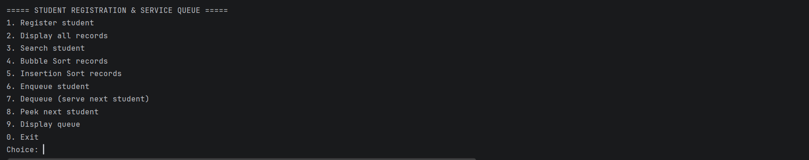

### 2. Adding and Displaying Records

**Figure 2.1: Students are registered with a student number, name, and year level.**

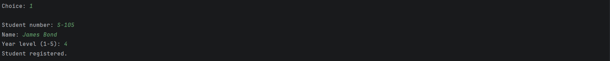

**Figure 2.2: All stored records shown in the order they were registered.**

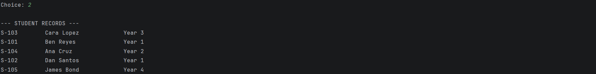

### 3. Searching for a Student

**Figure 3.1: Searching by student number or name displays the matching records, and partial entries are accepted.**

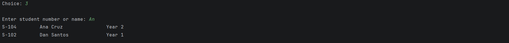

### 4. Queue Operations

**Figure 4.1: Registered students are added to the queue, and the system reports each one's position.**

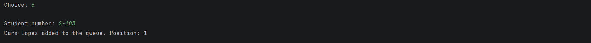

**Figure 4.2: Display queue shows the waiting students from front to back.**

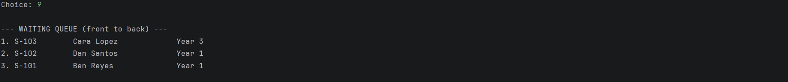

**Figure 4.3: Peek shows the next student without removing them.**

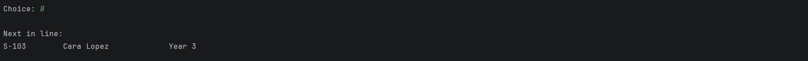

**Figure 4.4: Dequeue removes the front student from the queue and shows who is being served.**

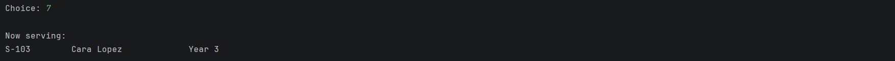

### 5. FIFO Behavior

**Figure 5.1: Students are served in the same order they were enqueued, so the first student added is the first served.**

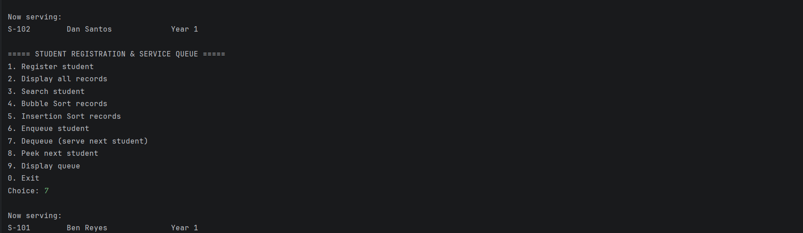

### 6. Bubble Sort (Algorithm 1)

**Figure 6.1: Records before and after Bubble Sort.**

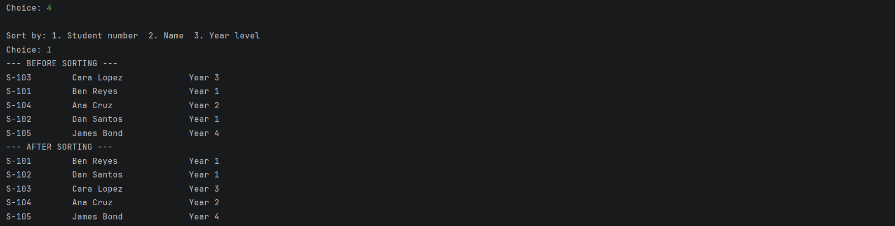

### 7. Insertion Sort (Algorithm 2)

**Figure 7.1: Records before and after Insertion Sort.**


### 8. Queue Unaffected by Sorting

**Figure 8.1: The queue is displayed after sorting and shows the same arrival order as before.**

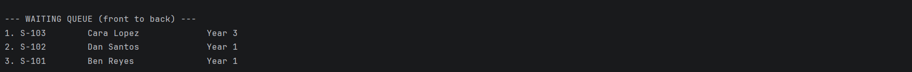

### 9. Input Validation and Error Messages

**Figure 9.1: Non-numeric and out-of-range menu entries are rejected and the program prompts again.**


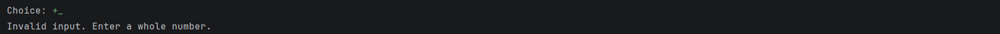

**Figure 9.2: Blank names, a duplicate student number, and an out-of-range year level are rejected.**

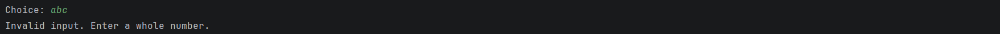

**Figure 9.3: Dequeuing from an empty queue and enqueuing or searching for a student that doesn't exist display clear messages.**


